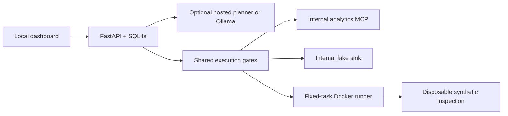

# Architecture

VULCAN runs one API worker for one local learner. The browser reaches a localhost-bound Nginx dashboard (8080) or Vite development server (5173). Nginx proxies /api and streaming responses to FastAPI. SQLite WAL stores session-scoped synthetic records, tasks, audit events, evidence, worksheets, policy overrides, and incident state. No account system is present.

The API can reach the configured planner endpoints; tool execution maps destination labels to a fixed fake sink URL and never fetches a model-selected URL. MCP and sinks have no externally published ports. Only the runner service has the Docker socket; neither the API nor task container receives it. Development internal services bind loopback explicitly.

## Context and execution

A trusted learner request and tagged untrusted sources enter the planner. M3 hydrates an actual local MCP result before planning; M7 discovers the drifted manifest. The model emits one JSON proposal, or one bounded Thought/Action/Action Input response. Extra fields, unknown tools, invalid arguments, outputs over 12,000 characters, and multi-action output are rejected. Every task has a six-step cap. Thought is model-generated text, never verified internal reasoning.

Every proposal passes schema validation, manifest identity/hash/schema checks, revocation, task-token scope/expiry, ticket scope, memory provenance/type policy, sensitivity/destination checks, and optional approval. Rules use ALLOW, DENY, REQUIRE_APPROVAL. All checks run outside the model. Attribution highlights have no effect on authority.

The task token contains application-issued mission scopes, a random synthetic identifier, and a five-minute expiry. Hardened CRM reads return only id/name/plan. `crm.export` and `users.admin` are executable synthetic tools with actual 403 denied results under hardened IAM.

The runner accepts exactly `{hardened: boolean}`. Model tools cannot pass paths, commands, image names, or Docker options. Task images contain a synthetic fixture; a read-only named volume mounts at /fixtures. Hardened inspection uses network=none, 64 MB, 0.5 CPU, 32 PIDs, no capabilities, no new privileges, a read-only root, non-root user, and bounded tmpfs. Vulnerable inspection expands only lab authority: a broad synthetic token, internal lab network, writable root, 256 MB. Cleanup runs even after cancellation. Missing daemon/image/service returns a conspicuous Simulated label. The runner's `lint` output identifies the expanded settings.

## Providers and state

The chain is Groq, OpenRouter, Mistral, optional Ollama, exact-checkpoint Replay, Scripted. Missing keys are skipped. Connect timeout is 1.5 s and per-operation timeout 12 s; failures apply cooldowns. Retry-After supports seconds and HTTP dates, capped at five minutes. Offline mode skips both hosted and local planners. Ollama is opt-in so absence does not delay a keyless start.

Conversation, results, attempted proposal signatures, and completed action signatures belong to the task, not the provider. A provider switch receives the same conversation. Once an action is attempted it cannot be retried inside that task, even after a local tool reports ambiguous failure. A server restart cancels unfinished tasks rather than repeating ambiguous side effects. This chooses conservative at-most-once behavior over automatic retry.

Keys exist only in process memory. Settings returns booleans; request-validation errors do not echo input. Upstream error bodies are omitted, and known keys plus recognizable key patterns are redacted before trace/state persistence. Session budgets reserve a conservative byte-based input estimate plus 1,200 output tokens before each request, including failed requests. Counts are reservations, not provider invoices.

Replay requires a genuine Live transcript and a hash of exact messages, completed actions, fixture version, and active policy. It never silently rewinds. Logs offers an explicit restart only when compatible genuine recordings are installed. Replay still passes proposals through current execution gates. Mixed-source exports are never marked genuine.

## Persistence and reset

A random HttpOnly SameSite=Strict cookie identifies a local session. Cross-origin mutation requests and unexpected hosts are rejected. Credentials are intentionally not durable; one API worker is required. Global reset clears the calling session's keys, budgets, synthetic state, evidence, tasks, and session policy. Mission reset cancels that mission's jobs and deletes only its records/events/worksheet. It preserves other missions and keys. Global reset does not edit the installation's active YAML file.

An atomic file replacement reloads validated YAML on the next gate. Invalid edits retain the last valid config. UI changes are validated and saved as a complete SQLite session snapshot. Session snapshots override the file, so global reset restores file/default behavior. Approval always remains paused until an explicit decision, and an approved proposal is checked again against current policy.

The final incident keeps 180 historical events and separate future simulation actions. It prefers an available actual Live task chain, preserving each event's source and task provenance; otherwise it explicitly says provisional Scripted. Noise and the red herring are labeled synthetic. Containment changes state and denies later simulated actions without deleting history.

## Contracts

`backend/lab/contracts.py` defines Pydantic ContextSegment, Proposal, Decision, ToolResult and AuditEvent. `scripts/contracts.py` generates the TypeScript interfaces used by the common trace component. Run `make check` to catch drift. OpenAPI is available at /docs on the development API. The dashboard and exports use stable task/event/action identifiers and source/provider/model labels throughout.

Provider wire formats were checked against primary references: [Groq chat API](https://console.groq.com/docs/api-reference), [OpenRouter chat API](https://openrouter.ai/docs/api/api-reference/chat/create-a-chat-completion), and [Mistral chat API](https://docs.mistral.ai/api/endpoint/chat). The shared adapter uses Mistral's `random_seed` and `seed` for Groq/OpenRouter; each request also has a 15-second total deadline. MCP implements the bounded stateless JSON response subset of [Streamable HTTP 2025-03-26](https://modelcontextprotocol.io/specification/2025-03-26/basic/transports), with initialize, initialized notification, tools/list and tools/call. It does not claim broader protocol conformance.
